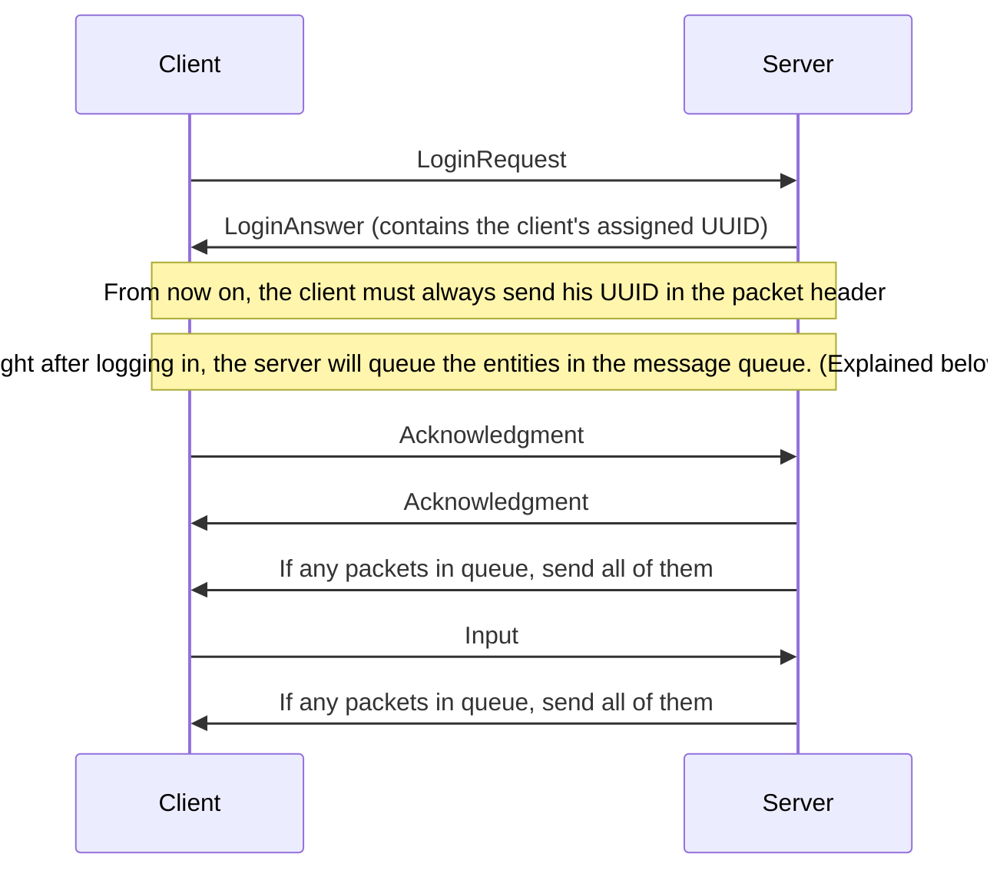

# Communication example

This document provides a simple communication example between the server and the client.

## Explanation

The first part (`LoginRequest` & `LoginAnswer`) constitutes the handshake and therefore logs in the client and creates a client inside the server if needed.

After the client logs in, the server queues up all entities to be read by the client.
