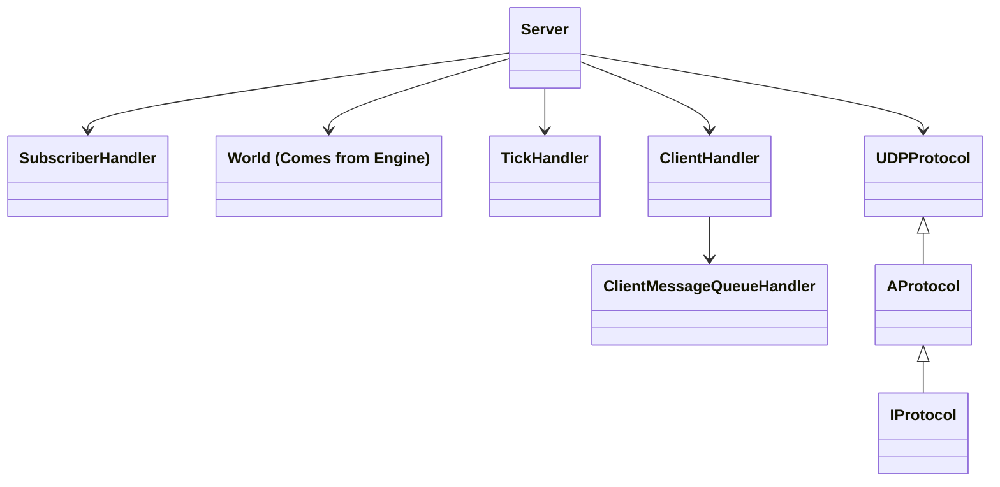

# Architecture

This document represents the architecture of the Server part of the r-type.

## Explanation

`SubscriberHandler` allows us to get the events from the engine (specifically, the ECS, which holds all systems) and then send them to the clients.

`ClientMessageQueueHandler` is what allows us to send the messages back to the client. We queue the messages to be sent at the end of the tick back to the client.
